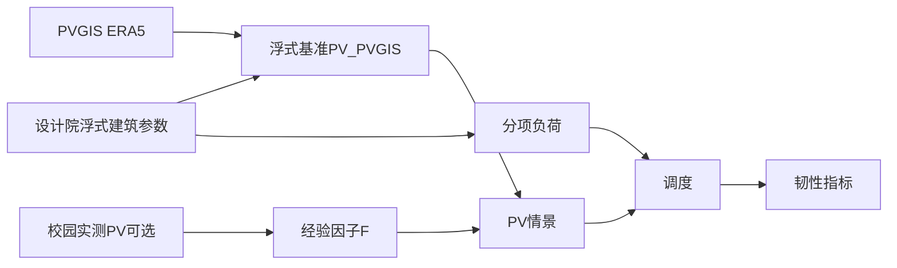

# 研究路线：浮式建筑光伏-负荷-储能调度与离岛韧性

本文档与 [README.md](README.md) 第 0 节配合，用于组会与论文阶段对齐**研究主体、数据来源、情景生成方式与实验矩阵**。

---

## 1. 研究定位

| 要素 | 说明 |
|------|------|
| **主案例** | 设计院水上浮式建筑（HKUST GZ Waterfront Living Lab 场景）：几何、BIPV、设计院年负荷与发电口径 |
| **基准模型** | PVGIS + 物理公式 → 浮式建筑逐时 `pv_kW`；分项负荷 + 年电量校准 → `load_kW` |
| **校园实测** | 能源中心 / 数据中心：**南沙本地 PV 波动与运行折减的参照**，**不**作为浮式建筑本体真值 |
| **创新侧重** | 储能调度（RBC / MILP / MPC）；极端天气下**离岛**与续航；水面微气候**不确定性**（灵敏度，非替代实测） |

神经网络拟合 `F(t)` 可作为**可选增强**，放在独立「PV prediction」仓库/章节；本仓库主线优先：**可解释的情景 + 调度与韧性**。

---

## 2. 数据流（逻辑）



**核心公式**（情景链）：

```text
PV_floating_scenario(t) = PV_floating_PVGIS(t) × F(t)
```

- `PV_floating_PVGIS(t)`：本仓库 `pv_generation.py` 输出（含浮式面积、朝向、效率、水面系数）。
- `F(t)`：由校园数据得到，典型构造见下节。`F≡1` 即为 Baseline（E0）。

---

## 3. 校园实测数据：学习产物（不含「换主体」）

### 3.1 归一化出力

对某栋楼、装机 `P_dc_kWp`：

```text
CF_meas(t) = P_meas_kW(t) / P_dc_kWp
```

用于跨楼比较形状与波动。夜间 `P_meas≈0` 时不再额外归一化解释。

### 3.2 经验扰动因子（相对 PVGIS / 理论）

若对同一楼栋建有 PVGIS 参考曲线 `PVGIS_site_ref(t)`（同坐标或同阵列参数）：

```text
F_meas(t) = P_meas_kW(t) / max(PVGIS_site_ref(t), ε)
```

`ε` 防止除零；夜间可强制 `F=0` 或跳过训练样本。`F_meas` **标签**即神经网络或统计模型的学习目标；应用到浮式建筑时：

```text
F_floating(t) ≈ model(气象, 时间, …)  或  按日型/月份统计的 F̄
```

### 3.3 非神经网络基线（建议先于深度模型）

- **日型聚类**：按日总发电量或形状聚类为晴 / 多云 / 阴 / 极端低发；每类给出 24h `CF` 或 `F` 典型曲线与分位数。
- **分位带**：按 `month × hour` 聚合 `F` 的 P10/P50/P90，生成保守/中性/乐观情景。
- **事件库**：从实测中剪裁连续 N 日低发片段，**时间平移或映射**到 2023 年浮式负荷时间轴做压力测试（E2）。

### 3.4 负荷（可选）

数据中心 / 能源中心负荷**不**直接代表浮式 Living Lab。若学校提供同期负荷，可用于：

- 校验南沙 **日内 / 季节**负荷形状假设；
- 讨论「真实楼宇」与「分项校准负荷」的差异；**不**强制合并进浮式主案例，除非有明确缩放假设并在文中披露。

申请字段见 [data_request.md](data_request.md)。

---

## 4. 实验矩阵与评价指标

### 4.1 情景编号（与 README 一致）

| ID | 名称 | PV | 负荷 | 电网 / 离岛 |
|----|------|----|------|-------------|
| **E0** | Baseline | `pv_generation_8760.csv`（`F=1`） | `load_8760.csv` | 未调度（已有 `pv_load_daily_compare.py`） |
| **E1** | LocalDisturbance | Baseline × `F`（校园统计或学习） | 同 E0 | 未调度或直接进入 E3–E5 |
| **E2** | ExtremeWeather | E0/E1 + 连续低 PV 或历史极端周 | 同 E0 | 指定窗口离岛 |
| **E3** | RBC | E0 或 E1 | 同 E0 | 并网；可切片离岛 |
| **E4** | MILP | E0 或 E1 | 同 E0 | 并网；可切片离岛 |
| **E5** | MPC | E0 或 E1 | 同 E0 | 并网；可切片离岛 |

**交叉**：`PV情景 {E0,E1} × 调度 {none,RBC,MILP,MPC} × 离岛 {无, 12h,24h,48h,72h}`。论文中可先报告「核心格子」，避免组合爆炸。

### 4.2 建议指标

| 类别 | 指标 |
|------|------|
| 能量 | 年购电量、年售电量、弃光、净电量、自发自用率 |
| 电池 | SOC 轨迹、循环深度、充放电次数 |
| 可靠性 | 缺电量、缺电小时数、max unmet、`LOLP`（若定义） |
| 离岛 | 离岛窗口内关键负荷覆盖比例、续航时间、最小可行电池容量扫描 |
| 经济性 | 年度电费（若电价给定）、敏感度（可选 LCOE） |
| 对比 | E0 vs E1 在同一调度下的购电/缺电差异；RBC vs MILP vs MPC |

### 4.3 代码实现顺序（建议）

1. 保持 E0 可一键复现（已有）。
2. 新增**数据 ingest**：读取校园 CSV，对齐时间戳，出 `CF`、`F` 统计与图（规划脚本名可如 `pv_local_pattern.py`，待定）。
3. 新增**情景写出**：`output/pv_generation_8760_scenario_*.csv`（规划 `pv_scenario_generation.py`）。
4. 实现 `dispatch.py`：先 RBC，再 MILP（`pulp`），再 MPC（滚动 MILP）。
5. `sensitivity.py`：水面 `albedo_factor`、`cooling_factor` 网格 + 固定 RBC 或 MILP。

---

## 5. 与任务书 PDF 的关系

[Cursor_workflow.md](Cursor_workflow.md) 中**任务 2**负荷公式为早期单列版本；**以当前 `load_generation.py` 为准**。任务 3–4 的 `dispatch.py`、`sensitivity.py` 与本文第 4.3 节对齐。

---

## 6. 组会需澄清的问题（可逐条勾选）

- [ ] 能源中心 / 数据中心：装机、逆变器限功率、关口计量点、数据时间粒度。
- [ ] 能否拿到与 PV **同期**的电表负荷或总用电。
- [ ] 离岛场景：断网时长假设、是否允许关键负荷削减。
- [ ] 电池参数：容量、功率、效率是否与 PDF 一致或可更新。

汇报逐页建议见 [deliverables/group_meeting_slides.md](deliverables/group_meeting_slides.md)。
